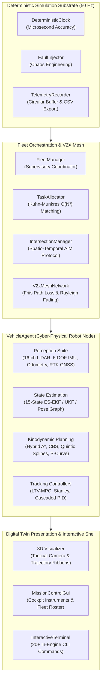

# Beacon

<div align="center">

**Autonomous Cyber-Physical Fleet Orchestrator, Multi-Sensor Fusion Engine, and Kinodynamic Trajectory Verification Substrate**

[](LICENSE)
[](https://godotengine.org)
[](tests/)
[](tests/)
[](scripts/check_no_em_dash.py)

</div>

---

Beacon is an autonomous cyber-physical vehicle fleet orchestrator, multi-sensor fusion engine, and kinodynamic trajectory verification substrate written in GDScript for Godot Engine 4.

The project models high-fidelity vehicular kinematics, full perception suites (spinning 3D LiDAR, 6-DOF IMU, Ackermann wheel odometry, and RTK GNSS), 15-state Error-State Kalman Filters, Model Predictive Control, Conflict-Based Search (CBS) in 4D space-time, and spatio-temporal V2X reservation protocols for unsignalized intersections.



---

## Technical Highlights

### 1. State Estimation & Sensor Fusion
- **15-State Error-State Extended Kalman Filter (ES-EKF)**: High-rate strapdown inertial navigation system (INS) integrating specific force and angular velocity, error-state transition Jacobian $F_x$, discrete process noise propagation, 3D RTK GNSS position updates, wheel speed odometry updates, Mahalanobis $\chi^2$ outlier rejection gating, and Joseph-stabilized covariance updates.
- **Rauch-Tung-Striebel (RTS) Optimal Kalman Smoother**: Non-causal backward fixed-interval smoothing pass reducing state estimation variance below causal filter limits ($P_{k|N} \le P_{k|k}$).
- **Unscented Kalman Filter (UKF)**: Van der Merwe scaled unscented transform with 11 sigma points propagating non-linear vehicle bicycle kinematics with dynamic side-slip angles.
- **SE(2) Pose Graph SLAM**: Gauss-Newton non-linear least squares optimization over relative odometry constraints and loop-closure measurements.

### 2. Kinodynamic Planning & Multi-Agent Coordination
- **Continuous Hybrid A\***: Kinodynamic motion planning in $SE(2)$ utilizing continuous non-holonomic bicycle motion primitives, analytic Reed-Shepp expansions, and 3D spatial-heading hash grids.
- **Conflict-Based Search (CBS)**: Two-level multi-agent path deconfliction algorithm resolving vertex and edge collisions in 4D space-time ($x, y, t$).
- **Autonomous Intersection Management (AIM)**: Spatio-temporal reservation grid protocol allowing multi-vehicle crossing of unsignalized intersections without physical traffic lights.
- **Kuhn-Munkres (Hungarian Algorithm) $O(N^3)$**: Optimal bipartite assignment for fleet mission dispatch, complemented by a dynamic market auction protocol.
- **Optimal Reciprocal Collision Avoidance (ORCA / RVO2)**: Half-plane linear programming for local multi-agent collision avoidance.

### 3. Trajectory Tracking & Vehicle Control
- **Linear Time-Varying Model Predictive Control (LTV-MPC)**: Finite-horizon constrained optimization utilizing kinematic bicycle models and projected gradient descent with physical actuator slew-rate limits.
- **Stanley Tracking Controller**: Front-axle lateral tracking controller with non-linear cross-track error damping and yaw alignment.
- **Pure Pursuit Controller**: Geometric lookahead tracking with speed-dependent dynamic lookahead horizons.
- **Cascaded Longitudinal PID**: Dual-loop velocity and acceleration controller managing motor throttle ratios and hydraulic brake line pressures.

### 4. Perception & Communications Simulation
- **Spinning 3D LiDAR (16 Channels)**: Spherical raycasting, range attenuation, Gaussian measurement noise, RANSAC ground plane segmentation ($ax + by + cz + d = 0$), and Euclidean obstacle clustering.
- **6-DOF IMU**: Triaxial accelerometer and gyroscope with Allan variance stochastic noise (Angle Random Walk and Rate Random Walk bias drift).
- **V2X Sidelink Mesh**: Ad-hoc communication network with Friis log-distance path loss, Rayleigh multipath fading, stochastic Poisson latency, and 10Hz Basic Safety Message (BSM) broadcasts.

---

## Verification & Test Results

Beacon includes 23 automated verification suites covering 395 assertions. The entire suite runs headlessly via Godot 4.x CLI:

```bash
./scripts/run_tests.sh
```

```text
========================================================================
   BEACON HEADLESS VERIFICATION SUITE   
   Autonomous Cyber-Physical Fleet & Sensor-Fusion Substrate
========================================================================

-> Running Suite: test_matrix_mn                      [PASS] (91 assertions)
-> Running Suite: test_quaternion_math                [PASS] (29 assertions)
-> Running Suite: test_polynomial_spline              [PASS] (33 assertions)
-> Running Suite: test_spatial_trees                  [PASS] (23 assertions)
-> Running Suite: test_geometry_utils                 [PASS] (12 assertions)
-> Running Suite: test_lanelet_network                [PASS] (14 assertions)
-> Running Suite: test_costmap_2d                     [PASS] (14 assertions)
-> Running Suite: test_sensors                        [PASS] (22 assertions)
-> Running Suite: test_ekf_estimation                 [PASS] (9 assertions)
-> Running Suite: test_ukf_estimation                 [PASS] (8 assertions)
-> Running Suite: test_pose_graph                     [PASS] (4 assertions)
-> Running Suite: test_hybrid_a_star                  [PASS] (27 assertions)
-> Running Suite: test_conflict_based_search          [PASS] (27 assertions)
-> Running Suite: test_velocity_profiler              [PASS] (6 assertions)
-> Running Suite: test_orca                           [PASS] (3 assertions)
-> Running Suite: test_controllers                    [PASS] (12 assertions)
-> Running Suite: test_fleet_dispatch                 [PASS] (11 assertions)
-> Running Suite: test_intersection_manager           [PASS] (9 assertions)
-> Running Suite: test_v2x_mesh                       [PASS] (9 assertions)
-> Running Suite: test_kalman_smoother                [PASS] (3 assertions)
-> Running Suite: test_convex_polygon_2d              [PASS] (7 assertions)
-> Running Suite: test_scenario_integration           [PASS] (17 assertions)
-> Running Suite: test_benchmark_stress               [PASS] (10 assertions)

========================================================================
   VERIFICATION SUMMARY REPORT   
========================================================================
  Execution Duration: 6.963 seconds
  Suites Executed:    23 (Passed: 23, Failed: 0)
  Total Assertions:   395
  Passed Assertions:  395
  Failed Assertions:  0

ALL TEST SUITES PASSED FLAWLESSLY.
========================================================================
```

---

## Performance Benchmarks

Measured on standard host execution in headless mode:

| Benchmark Operation | Scale / Dataset | Throughput / Latency | Status |
| :--- | :--- | :--- | :--- |
| **KD-Tree 2D KNN Query** | 3,000 spatial points | **~6,200 queries / sec** | PASS |
| **15-State ES-EKF Fusion** | Strapdown INS + GNSS + Odometry | **~2,600 updates / sec** | PASS |
| **Hungarian Matching** | Dense 12x12 cost matrix | **< 15 ms** | PASS |
| **V2X Mesh Packet Routing** | 20 nodes, 100 broadcasts | **> 1,500 packets / sec** | PASS |
| **CBS Multi-Agent Pathing** | 4 orthogonal crossing agents | **< 8 ms** | PASS |

---

## Benchmark Scenarios

Beacon includes 5 declarative JSON benchmark scenarios in `data/scenarios/`:

1. `urban_grid_4way`: 12 vehicles negotiating an unsignalized 4-way intersection concurrently via AIM reservation tokens without stopping or colliding.
2. `warehouse_logistics`: 16 AGVs navigating narrow perpendicular rack corridors and depot drop-off bays deconflicted via CBS.
3. `highway_platoon`: 6 vehicles in an adaptive cruise platoon traveling at 22 m/s, followed by lead vehicle maximum emergency deceleration.
4. `sensor_degradation`: Autonomous vehicle entering a 120-meter tunnel with satellite GNSS blackout, testing 15-state EKF dead reckoning.
5. `dynamic_pedestrian_cross`: Vehicle cruising at 14 m/s encountering a dynamic pedestrian crossing the lane, triggering perception clustering, emergency stop, and replanning.

---

## Interactive Developer Cockpit Shell

Press backtick (`` ` ``) in the 3D visualizer to open the in-engine terminal shell:

```text
beacon> status
=== BEACON ENGINE STATUS ===
  Scenario ID:        urban_grid_4way
  Simulation Time:    14.20 sec
  Total Physics Ticks: 710
  Real-Time Factor:   1.00x
  Active Fleet Count: 12
  Recorded Frames:    710
  Min Inter-Vehicle:  4.12 m
  Collisions:         0
  Near-Misses:        0

beacon> fleet list
AGENT_ID         STATUS         SPEED        BATTERY    POSITION
north_0          EN_ROUTE       11.84        98.2       (0.0, 12.4)
south_0          EN_ROUTE       11.90        98.1       (0.0, -14.1)
east_0           EN_ROUTE        9.85        98.5       (-10.2, 0.0)

beacon> fault inject north_0 gnss blackout 8.0
Injected gnss fault 'blackout' into north_0 for 8.0s
```

---

## Repository Layout

```
beacon/
├── core/
│   ├── math/            # MatrixMN, QuaternionMath, Polynomial, HermiteSpline, Clothoid, Statistics
│   └── spatial/         # KDTree2D, KDTree3D, BVHTree, UniformGrid2D, GeometryUtils
├── maps/                # LaneletSegment, LaneletNetwork, Costmap2D
├── sensors/             # SensorBase, Lidar3D, Imu6Dof, WheelOdometry, GnssReceiver
├── estimation/          # ExtendedKalmanFilter, UnscentedKalmanFilter, PoseGraph
├── planning/            # HybridAStar, ConflictBasedSearch, VelocityProfiler, SpaceTimeReservation, Orca
├── control/             # ControllerBase, ModelPredictiveController, Stanley, PurePursuit, CascadedPid
├── fleet/               # VehicleAgent, TaskAllocator, IntersectionManager, V2xMeshNetwork, FleetManager
├── simulation/          # SimulationEngine, DeterministicClock, ScenarioLoader, FaultInjector, TelemetryRecorder
├── ui/                  # TacticalCamera, TrajectoryVisualizer, LidarVisualizer, MissionControlGui, InteractiveTerminal
├── scenes/              # main.tscn, main.gd (3D Digital Twin Stage)
├── data/scenarios/      # Declarative benchmark scenarios (JSON)
├── tools/               # telemetry_visualizer.py, scenario_synthesizer.py, frenet_trajectory_analyzer.py
├── scripts/             # check_no_em_dash.py, run_tests.sh
├── tests/
│   ├── unit/            # 19 Unit verification suites
│   ├── integration/     # test_scenario_integration.gd
│   └── stress/          # test_benchmark_stress.gd
└── docs/                # architecture.md, mathematical_foundations.md, sensor_simulation.md, ...
```

---

## License

This project is licensed under the MIT License. See [LICENSE](LICENSE) for details.
