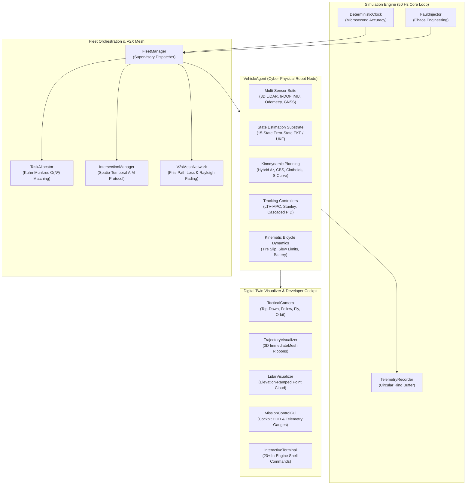
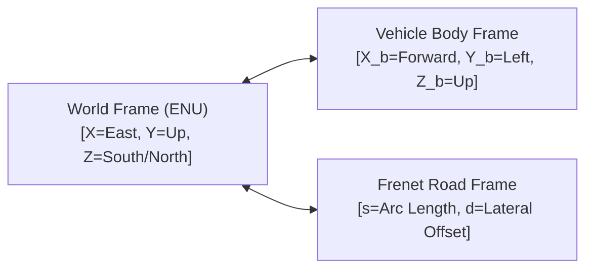
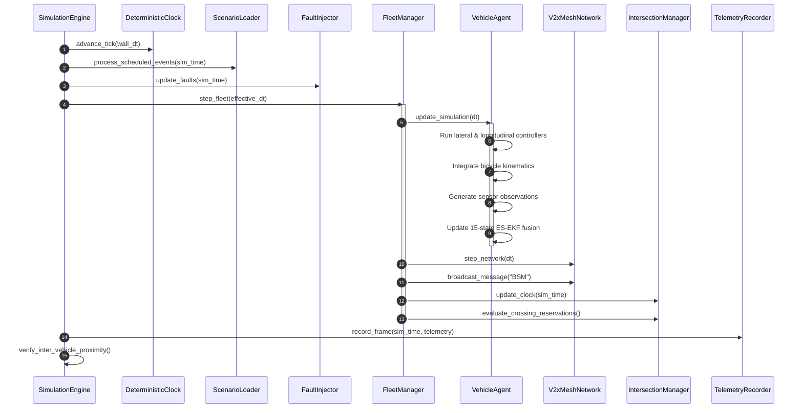

# System Architecture

Beacon is an autonomous cyber-physical fleet orchestration substrate, multi-sensor fusion engine, and kinodynamic trajectory verification framework built natively in GDScript for Godot Engine 4.

This document details the high-level architecture, module decomposition, coordinate reference frames, 50Hz discrete integration pipeline, and dataflow topologies.

---

## 1. Subsystem Decomposition

The repository is structured into modular, decoupled domains:

| Module Directory | Primary Responsibility | Key Classes |
| :--- | :--- | :--- |
| `core/math/` | Arbitrary-dimension linear algebra, Lie algebra, polynomials, splines, and probability | `MatrixMN`, `QuaternionMath`, `Polynomial`, `HermiteSpline`, `Clothoid`, `Statistics` |
| `core/spatial/` | Spatial indexing trees, bounding hierarchies, and computational geometry | `KDTree2D`, `KDTree3D`, `BVHTree`, `UniformGrid2D`, `GeometryUtils` |
| `maps/` | Lanelet2 road network topologies and multi-layer costmaps | `LaneletSegment`, `LaneletNetwork`, `Costmap2D` |
| `sensors/` | Multi-sensor physics modeling with Allan variance and raycasting | `SensorBase`, `Lidar3D`, `Imu6Dof`, `WheelOdometry`, `GnssReceiver` |
| `estimation/` | 15-state ES-EKF strapdown INS, UKF, and SE(2) Pose Graph SLAM | `ExtendedKalmanFilter`, `UnscentedKalmanFilter`, `PoseGraph` |
| `planning/` | Hybrid A* kinodynamic search, CBS multi-agent coordination, and velocity profiling | `HybridAStar`, `ConflictBasedSearch`, `VelocityProfiler`, `SpaceTimeReservation`, `OrcaCollisionAvoidance` |
| `control/` | Lateral and longitudinal vehicle trajectory tracking | `ControllerBase`, `ModelPredictiveController`, `StanleyController`, `PurePursuitController`, `CascadedPidController` |
| `fleet/` | Multi-robot task allocation, V2X mesh communication, and intersection management | `VehicleAgent`, `TaskAllocator`, `IntersectionManager`, `V2xMeshNetwork`, `FleetManager` |
| `simulation/` | Master simulation orchestration, deterministic clock, chaos faults, and flight recorder | `SimulationEngine`, `DeterministicClock`, `ScenarioLoader`, `FaultInjector`, `TelemetryRecorder` |
| `ui/` & `scenes/` | 3D digital twin presentation, tactical camera, HUD instrumentation, and CLI shell | `TacticalCamera`, `TrajectoryVisualizer`, `LidarVisualizer`, `MissionControlGui`, `InteractiveTerminal`, `MainSimulationScene` |

---

## 2. Coordinate Systems & Reference Frames

Beacon enforces consistent transformations across three primary coordinate frames:

1. **East-North-Up (ENU) World Frame**:
   Cartesian reference frame where $+X$ points East, $+Y$ points Upward (elevation), and $+Z$ points South (matching Godot 3D convention).
2. **Vehicle Body Frame**:
   Rigid-body frame centered at the center of the rear axle. $+X_b$ points forward along the longitudinal vehicle axis, $+Y_b$ points leftward (lateral axis), and $+Z_b$ points upward (normal axis).
3. **Frenet-Serret Road Frame $(s, d)$**:
   Curvilinear coordinates defined along road centerlines. Coordinate $s$ measures longitudinal arc-length distance from the segment origin, while $d$ represents signed orthogonal lateral displacement ($d > 0$ for left, $d < 0$ for right).

---

## 3. Discrete Simulation Pipeline (50 Hz Fixed Step)

Every simulation tick advances the engine by exactly $\Delta t = 0.02$ seconds ($50\text{ Hz}$). The execution order inside each cycle is strictly deterministic:

---

## 4. Concurrency & Determinism Model

Beacon guarantees bitwise-deterministic execution across all simulation runs:
- **Pseudo-Random Number Generator (PRNG)**: Sensor noise, RF fading, and latency jitter derive from explicit deterministic seeds.
- **Fixed-Step Numerical Integration**: Physics, strapdown inertial mechanization, and vehicle odometry rely strictly on the `DeterministicClock` fixed step, completely decoupled from visual frame rates.
- **Ordered Iteration**: Spatial hash tables, task allocation bipartite sets, and conflict trees sort IDs deterministically before processing to prevent dictionary iteration order divergence.
