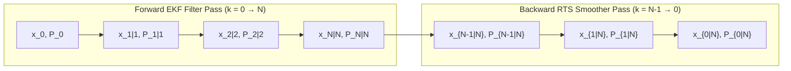

# Kinodynamic Smoothing & Convex Geometric Verification

This document details the mathematical theory for Rauch-Tung-Striebel (RTS) backward trajectory smoothing and planar convex polygon operations in Beacon.

---

## 1. Rauch-Tung-Striebel (RTS) Optimal Kalman Smoother

While the forward Extended Kalman Filter produces causal state estimates $\hat{\mathbf{x}}_{k|k}$ conditioned only on past observations $\mathbf{z}_{1:k}$, post-flight telemetry analysis benefits from non-causal smoothing conditioned on the entire batch $\mathbf{z}_{1:N}$.

### 1.1 Backward Smoother Recursion
At step $k \in \{N-1, \dots, 0\}$, the smoother computes the backward gain matrix $\mathbf{G}_k$:

$$\mathbf{G}_k = \mathbf{P}_{k|k} \mathbf{F}_k^T \mathbf{P}_{k+1|k}^{-1}$$

The smoothed state estimate is:

$$\hat{\mathbf{x}}_{k|N} = \hat{\mathbf{x}}_{k|k} + \mathbf{G}_k \left(\hat{\mathbf{x}}_{k+1|N} - \hat{\mathbf{x}}_{k+1|k}\right)$$

The smoothed state error covariance is:

$$\mathbf{P}_{k|N} = \mathbf{P}_{k|k} + \mathbf{G}_k \left(\mathbf{P}_{k+1|N} - \mathbf{P}_{k+1|k}\right) \mathbf{G}_k^T$$

Because $\mathbf{P}_{k+1|N} \le \mathbf{P}_{k+1|k}$ (in the Loewner order of positive semi-definite matrices), the term in parentheses is negative semi-definite, guaranteeing:

$$\mathbf{P}_{k|N} \le \mathbf{P}_{k|k}$$

The backward pass strictly reduces state estimation variance across the trajectory.

---

## 2. Planar Convex Polygon Operations

### 2.1 Shoelace Area Formula
For a non-self-intersecting planar polygon with ordered vertices $\{ (x_0, y_0), \dots, (x_{n-1}, y_{n-1}) \}$, the exact signed area is:

$$A = \frac{1}{2} \left| \sum_{i=0}^{n-1} (x_i y_{i+1} - x_{i+1} y_i) \right|$$

with cyclic index $n \equiv 0$.

### 2.2 Geometric Centroid
The polygon center of mass is:

$$C_x = \frac{1}{6A} \sum_{i=0}^{n-1} (x_i + x_{i+1})(x_i y_{i+1} - x_{i+1} y_i)$$
$$C_y = \frac{1}{6A} \sum_{i=0}^{n-1} (y_i + y_{i+1})(x_i y_{i+1} - x_{i+1} y_i)$$

### 2.3 Sutherland-Hodgman Polygon Clipping
To determine intersection clearance between vehicle swept footprints and road boundary envelopes, polygons are clipped against half-planes $\mathcal{H} = \{ \mathbf{p} \in \mathbb{R}^2 \mid (\mathbf{p} - \mathbf{p}_0) \cdot \mathbf{n} \ge 0 \}$.

For each polygon edge $\mathbf{s} \to \mathbf{e}$:
- If both $\mathbf{s}$ and $\mathbf{e}$ are inside $\mathcal{H}$, $\mathbf{e}$ is added.
- If $\mathbf{s}$ is outside and $\mathbf{e}$ is inside, the edge-plane intersection $\mathbf{i}$ and $\mathbf{e}$ are added.
- If $\mathbf{s}$ is inside and $\mathbf{e}$ is outside, intersection $\mathbf{i}$ is added.
- If both are outside, no vertex is added.
