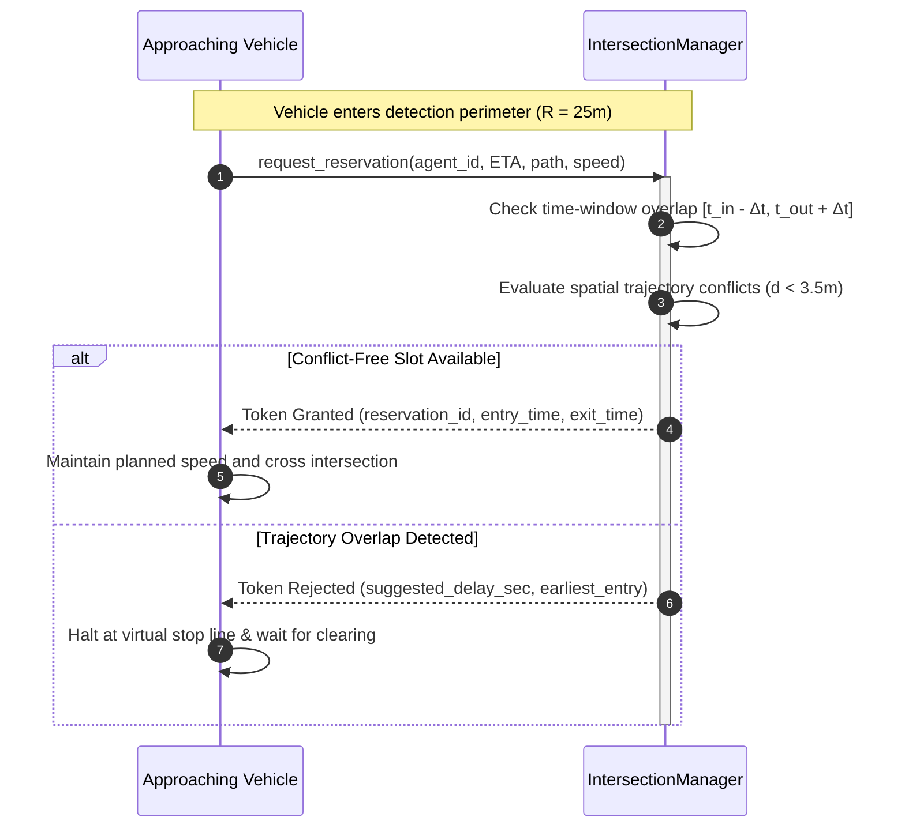

# Multi-Agent Fleet Coordination & V2X Protocols

This document details the multi-robot coordination mechanisms, Autonomous Intersection Management (AIM) reservation protocol, and V2X mesh communication simulation in Beacon.

---

## 1. Autonomous Intersection Management (AIM) Protocol

Beacon coordinates multi-vehicle unsignalized intersections using an automated spatio-temporal reservation protocol, eliminating conventional traffic light latency while maintaining guaranteed collision avoidance.

### 1.1 Spatio-Temporal Conflict Detection
An intersection reservation request is parameterized by entry time $t_{in}$, exit time $t_{out}$, and spatial trajectory $\mathcal{T} = \{\mathbf{p}_0, \mathbf{p}_1, \dots, \mathbf{p}_k\}$.

Two reservations $A$ and $B$ conflict if their temporal bounds overlap within safety buffer $\Delta t_{safe} = 0.8\text{ s}$:

$$[t_{in}^A - \Delta t_{safe}, t_{out}^A + \Delta t_{safe}] \cap [t_{in}^B - \Delta t_{safe}, t_{out}^B + \Delta t_{safe}] \neq \emptyset$$

and their spatial swept paths violate the minimum safety clearance:

$$\min_{\mathbf{p}_A \in \mathcal{T}_A, \mathbf{p}_B \in \mathcal{T}_B} \|\mathbf{p}_A - \mathbf{p}_B\|_2 < d_{clear} = 3.5\text{ m}$$

---

## 2. V2X Sidelink Mesh Communication Network

Vehicular ad-hoc communications model direct device-to-device RF sidelinks (C-V2X PC5 / IEEE 802.11p DSRC).

### 2.1 RF Channel Propagation Model
Signal attenuation follows the log-distance path loss formulation with path loss exponent $\gamma = 2.8$ (typical urban environment):

$$PL(d) = PL(d_0) + 10 \gamma \log_{10}\left(\frac{d}{d_0}\right) + X_\sigma$$

where $X_\sigma \sim \mathcal{N}(0, \sigma^2)$ models log-normal shadow fading.

### 2.2 Stochastic Rayleigh Multipath Packet Drops
The probability of packet loss $P_{drop}$ increases non-linearly with distance $d$ relative to reference distance $d_0 = 100\text{ m}$:

$$P_{drop}(d) = 1.0 - \exp\left( - \left(\frac{d}{d_0}\right)^\gamma \cdot 0.15 \right)$$

Packets beyond the maximum communication range $R_{max} = 250\text{ m}$ are dropped unconditionally.

### 2.3 Stochastic Transmission Latency
Transmission latency includes channel contention, queue delays, and propagation delay:

$$\Delta t_{latency} = t_{base} + \delta_{jitter} + \frac{d}{c}$$

where $t_{base} = 10.0\text{ ms}$, $\delta_{jitter} \in [-2\text{ ms}, +8\text{ ms}]$, and $c = 3 \times 10^8\text{ m/s}$.

---

## 3. Multi-Robot Task Allocation (MRTA)

### 3.1 Kuhn-Munkres Optimal Bipartite Assignment
For batch dispatching $N$ idle vehicles to $M$ task destinations, the cost matrix $C_{ij}$ is formed:

$$C_{ij} = \|\mathbf{p}_{agent, i} - \mathbf{p}_{task, j}\|_2$$

The Kuhn-Munkres algorithm computes the global minimum-cost one-to-one matching in $O(K^3)$ where $K = \max(N, M)$.

### 3.2 Dynamic Market-Based Auction
For asynchronous single-task arrivals, idle agents submit bids based on distance, battery state, and current queue load:

$$\text{Bid}_i = w_{dist} \cdot d_i + w_{soc} \cdot (1.0 - \text{SoC}_i) + w_{queue} \cdot q_i$$

Vehicles with $\text{SoC} < 0.15$ are disqualified from bidding to prevent stranding.
