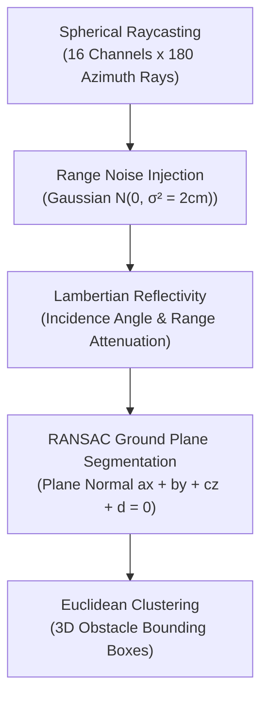

# Sensor Physics & Noise Simulation

This document describes the physical principles, stochastic error models, and signal processing pipelines implemented in Beacon's sensor suite.

---

## 1. 16-Channel Spinning 3D LiDAR

The `Lidar3D` class models a pulsed time-of-flight spinning LiDAR sensor (modeled on the Velodyne VLP-16 Puck).

### 1.1 Beam Geometry
- **Channels**: 16 vertical beams spanning elevation $\phi \in [-15^\circ, +15^\circ]$.
- **Azimuth Resolution**: $\Delta \theta = 2.0^\circ$ yielding 180 rays per revolution.
- **Maximum Detection Range**: $80.0\text{ m}$.

### 1.2 Point Cloud Signal Attenuation
The reflected optical intensity $I$ is modeled as a function of range $r$ and surface incidence angle $\alpha$:

$$I(r, \alpha) = I_0 \cdot \rho \cdot \frac{\cos\alpha}{r^2} \cdot \exp(-2\gamma r)$$

where $\rho \in [0.1, 0.9]$ is surface material reflectivity, and $\gamma$ is atmospheric extinction.

### 1.3 RANSAC Ground-Plane Segmentation
To isolate traversable roadway from obstacles, RANSAC iteratively fits a plane $\mathbf{n} \cdot \mathbf{p} + d = 0$ over candidate ground points:
1. Sample three non-collinear points $\mathbf{p}_1, \mathbf{p}_2, \mathbf{p}_3$.
2. Compute candidate normal: $\mathbf{n} = (\mathbf{p}_2 - \mathbf{p}_1) \times (\mathbf{p}_3 - \mathbf{p}_1)$.
3. Count inlier points satisfying $\frac{|\mathbf{n} \cdot \mathbf{p} + d|}{\|\mathbf{n}\|} < \epsilon_{dist}$ and $|\mathbf{n}_y| > \cos(15^\circ)$.
4. Extract points above the ground plane into obstacle clusters via Euclidean distance grouping.

---

## 2. 6-DOF Inertial Measurement Unit (IMU)

The `Imu6Dof` class models tactical-grade MEMS triaxial accelerometers and gyroscopes with Allan variance stochastic noise.

### 2.1 Measurement Model
The specific force $\mathbf{f}_b$ measured by the accelerometer proof mass in the vehicle body frame is:

$$\mathbf{f}_b = \mathbf{a}_b + \mathbf{R}_{wb}^T \mathbf{g}_w + \mathbf{b}_a + \mathbf{w}_a$$

where:
- $\mathbf{a}_b$: True body linear acceleration ($m/s^2$)
- $\mathbf{g}_w = [0, 9.80665, 0]^T$: World gravity vector pointing upward on proof mass
- $\mathbf{R}_{wb}$: Body-to-world rotation matrix
- $\mathbf{b}_a$: Accelerometer bias drift ($m/s^2$)
- $\mathbf{w}_a \sim \mathcal{N}(\mathbf{0}, \sigma_a^2 \mathbf{I})$: Velocity Random Walk (VRW) white noise

The angular rate measured by the gyroscope is:

$$\boldsymbol{\omega}_{meas} = \boldsymbol{\omega}_b + \mathbf{b}_g + \mathbf{w}_g$$

where $\mathbf{b}_g$ is gyroscope bias drift and $\mathbf{w}_g \sim \mathcal{N}(\mathbf{0}, \sigma_g^2 \mathbf{I})$ is Angle Random Walk (ARW).

### 2.2 Allan Variance Bias Random Walk
Dynamic sensor biases evolve via continuous Brownian motion:

$$\mathbf{b}_{a, k+1} = \mathbf{b}_{a, k} + \mathcal{N}\left(\mathbf{0}, \sigma_{ba}^2 \Delta t \mathbf{I}_3\right)$$
$$\mathbf{b}_{g, k+1} = \mathbf{b}_{g, k} + \mathcal{N}\left(\mathbf{0}, \sigma_{bg}^2 \Delta t \mathbf{I}_3\right)$$

---

## 3. Wheel Encoder Odometry

The `WheelOdometry` class simulates optical wheel rotation encoders.

### 3.1 Runge-Kutta 2nd Order (Midpoint) Dead Reckoning
Given forward speed $v$ and front wheel steering angle $\delta$, the yaw rate is:

$$\omega = \frac{v}{L} \tan(\delta)$$

The midpoint orientation and position updates are:

$$\theta_{mid} = \theta_k + \frac{1}{2} \omega \Delta t$$
$$x_{k+1} = x_k + v \cos(\theta_{mid}) \Delta t$$
$$y_{k+1} = y_k + v \sin(\theta_{mid}) \Delta t$$
$$\theta_{k+1} = \theta_k + \omega \Delta t$$

### 3.2 Dynamic Tire Slip
Tire longitudinal slip is modeled as a function of wheel load and speed:

$$s_{slip} = 1.0 - 0.02 \cdot \left(\frac{|v|}{20.0}\right)$$

---

## 4. RTK GNSS Receiver

The `GnssReceiver` class models Real-Time Kinematic satellite positioning.

### 4.1 Covariance Scaling via Dilution of Precision
Position covariance expands dynamically based on satellite constellation geometry:

$$\sigma_{horizontal} = \sigma_{base} \cdot \text{HDOP}$$
$$\sigma_{vertical} = \sigma_{base} \cdot \text{VDOP}$$

Typical nominal RTK fixed precision is $\sigma_{horizontal} = 2.0\text{ cm}$.

### 4.2 Urban Canyon Multipath & Tunnel Blackout
- **Multipath Reflections**: Satellite signal bounces introduce pseudorange delays modeled as Gaussian step biases ($\Delta p \approx 3.5\text{ m}$).
- **Tunnel Blackout**: Satellite line-of-sight loss sets the fix type to `NO_FIX`, forcing downstream state estimators to navigate purely on dead reckoning and LiDAR odometry.
